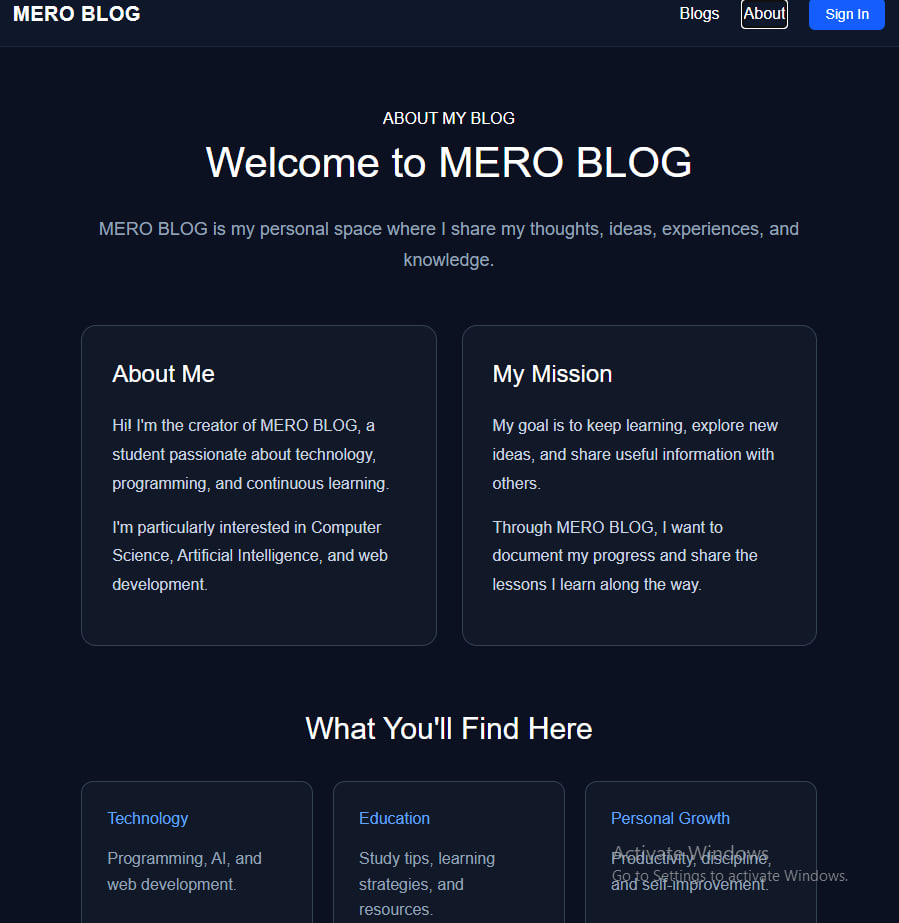
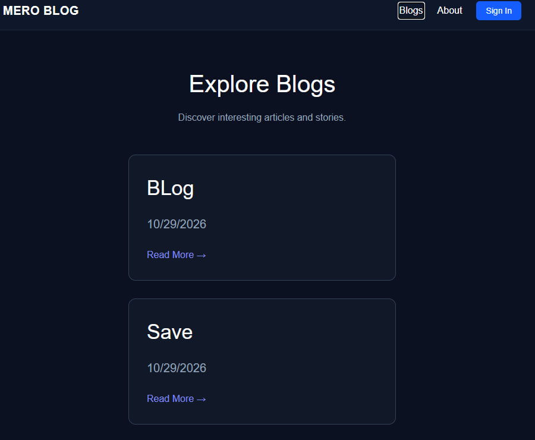

# MERO - blog
## Create an Account
1. Open the Sign Up page.
2. Enter your name and email address.
3. Create a password with at least 8 characters. Choose a password for your own account.
Click Submit to complete registration.
## Sign In
1. Enter your registered email address and password.
2. Click Submit to log in.
3. If your password is incorrect, you will see an "Incorrect password" message.
## Purpose
It is for reveal my thoughts in modern and proper way to more people, therefore I decided to develop project like that. Now, everyone can use it for blog anything they want

## About
MeroBlog is based on my Username and it means blogs of Meroquixel's, so it very own project
## Capabilities
1. Adding and deleting post to audience 
2. meaningful time and joy for users
3. exchange emotions with my project
## Parts
1. delete button for delete meaningless posts
2. Sing up for enter pletform
3. NavBar to navigate easily
4. Adding post with title, text, url and Image

## Technologies
1. CSS
2. TypeScript
3. React
   

[Live Demo](https://mero-blog-ochre.vercel.app)
